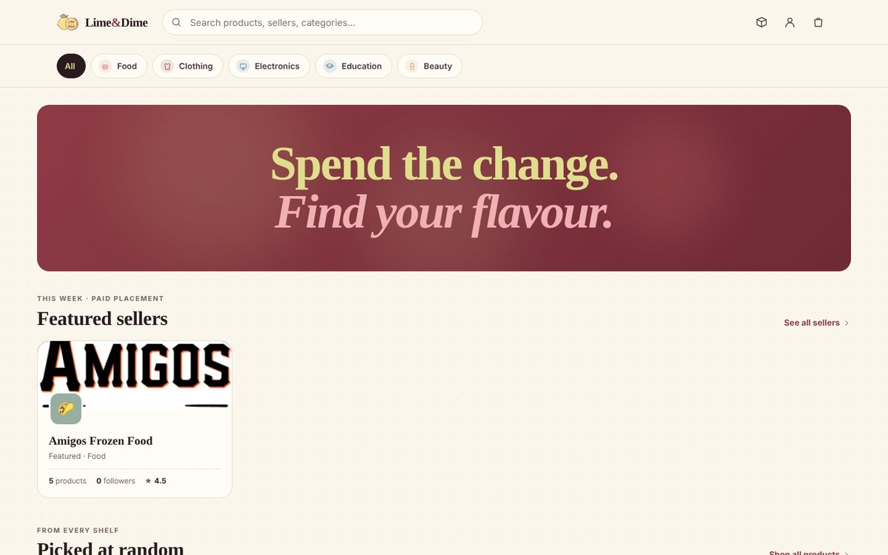
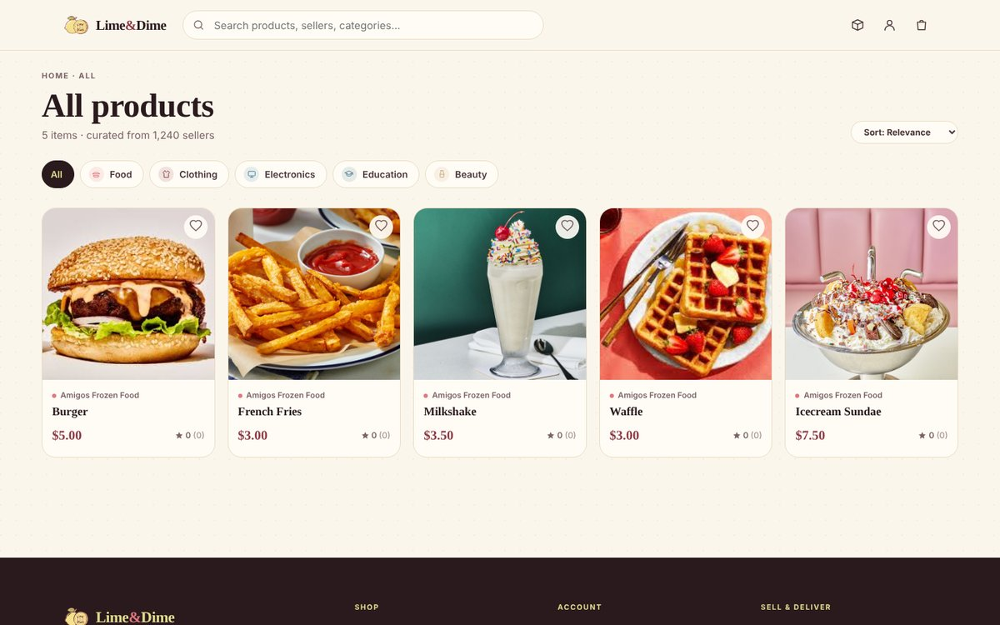
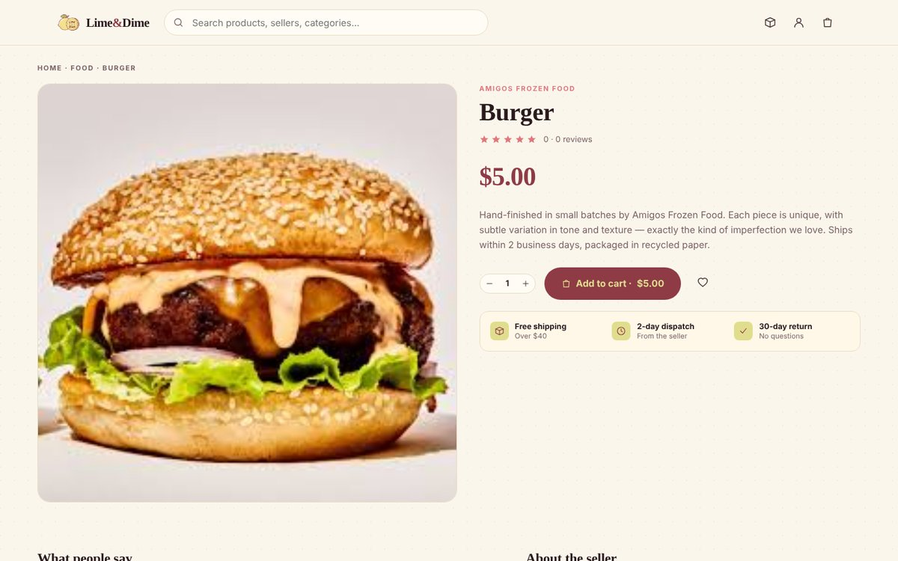
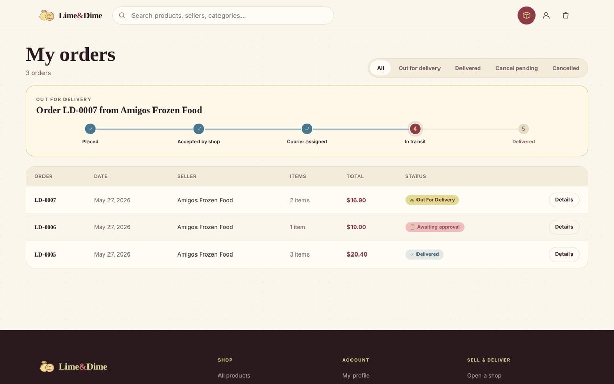
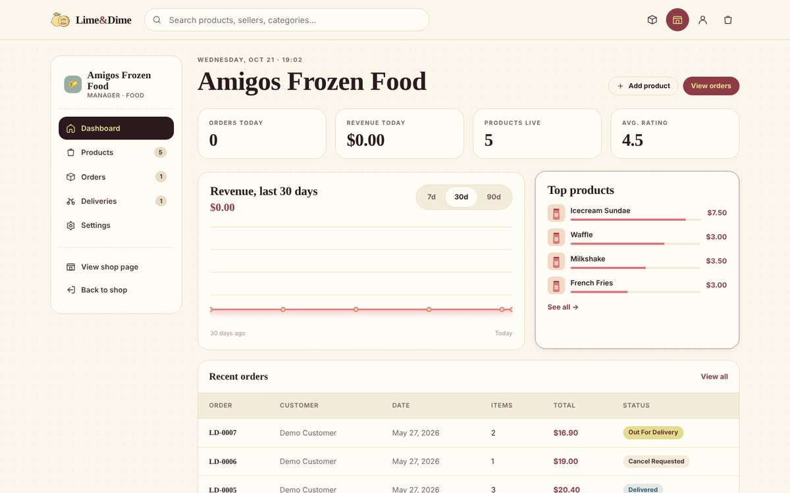
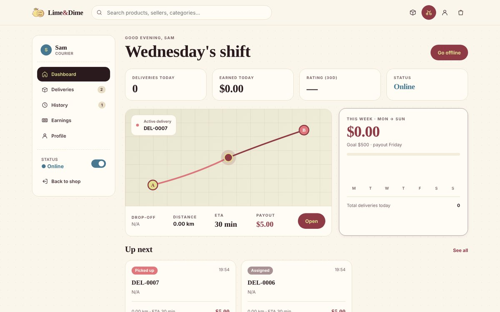
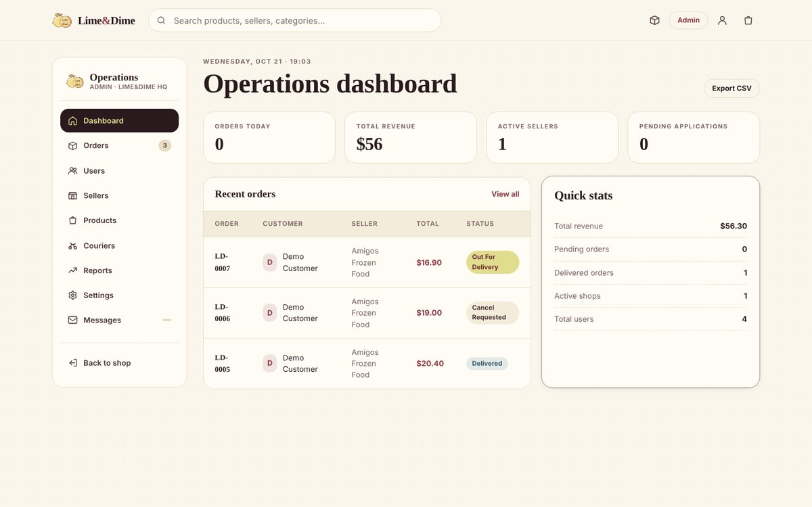

# Lime&Dime

A small-scale online marketplace built with PHP and MySQL, with four user roles: customers shop from local sellers, sellers manage their shops, couriers deliver orders, and admins oversee the platform.


## Overview

Lime&Dime started as a university assignment for a "Digital Mall System" with three roles (Admin, Manager, Customer) and grew into a fuller marketplace. A fourth role, **Courier**, was added so the order flow could run end to end: an order is placed by a customer, prepared by the seller, picked up and delivered by a courier, and monitored by the admin.

The goal was a platform that feels warm and handcrafted while staying professional, something small local businesses would actually enjoy using.

## Screenshots



| Product catalog | Product detail |
| --- | --- |
|  |  |
| **Order tracking** | **Seller panel** |
|  |  |
| **Courier panel** | **Admin panel** |
|  |  |

## Features

**Customer**
- Registration and login with hashed passwords (`password_hash` / `password_verify`)
- Homepage with featured sellers and products
- Category browsing (Food, Clothing, Electronics, Education, Beauty), search and sorting
- Product and seller pages with reviews and related products
- Cart and 3-step checkout (address, delivery type, payment)
- Order history with status tracker and cancellation requests
- Profile with addresses, saved cards, favorites and password change

**Seller** (`manager.php`)
- Multi-step seller registration
- Dashboard with daily revenue, pending orders and a 30/60/90-day revenue chart (SVG)
- Product management with photo upload
- Order tracking and approval of cancellation requests
- Shop settings: name, logo, accent color, cover photo

**Courier** (`courier.php`)
- Multi-step registration with document upload
- Online/offline status
- Accepting, picking up and delivering orders
- Delivery history and earnings statistics

**Admin** (`admin.php`)
- Operations dashboard and order management
- User management: suspend, activate, delete, approve applications
- Shop and courier management, including document review
- Platform settings: commission rates and operating regions

## Order Lifecycle

```
pending → accepted → packed → out_for_delivery → delivered
              └──────────→ cancel_requested → cancelled (seller approval)
```

## Tech Stack

| Layer | Technology |
| --- | --- |
| Backend | PHP 7.4+ (procedural, `mysqli`) |
| Database | MySQL / MariaDB with foreign keys |
| Frontend | HTML, custom CSS design system, vanilla JavaScript |
| Charts and illustrations | Hand-built inline SVG |
| Environment | XAMPP (Apache + MySQL) |

## Project Structure

```
limedime/
├── _partials/            # Shared building blocks
│   ├── connect.php       # Database connection
│   ├── session.php       # Session helpers, require_login(), require_role()
│   ├── data.php          # Shared data loaded by pages
│   ├── header.php        # Site header
│   ├── footer.php        # Site footer
│   ├── icons.php         # SVG icon helpers
│   └── illustrations.php # SVG product/shop illustrations
├── assets/
│   ├── css/styles.css    # Design system
│   ├── js/app.js         # Favorites and cart counter
│   ├── img/              # Logo, product and shop images
│   └── docs/             # Uploaded application documents (not tracked)
├── database/
│   └── lime_dime_db.sql  # Schema and demo data
├── docs/                 # Screenshots and original course report
├── index.php, category.php, product.php, sellers.php, seller.php
├── cart.php, checkout.php, order-success.php, orders.php, profile.php
├── login.php, register.php, manager-register.php, courier-register.php, logout.php
├── admin.php, manager.php, courier.php
└── about.php, privacy.php, terms.php, contact.php
```

The three panels (`admin.php`, `manager.php`, `courier.php`) each contain several tabbed views in a single file, while customer-facing pages are split by purpose. Shared layout and logic live in `_partials/` to avoid repetition.

## User Roles

| Role | Access | Lands on |
| --- | --- | --- |
| `customer` | Storefront and profile | `index.php` |
| `seller` | Seller panel | `manager.php` |
| `courier` | Courier panel | `courier.php` |
| `admin` | Everything | `admin.php` |

Access control is handled by `require_login()` and `require_role()` in `_partials/session.php`.

## Getting Started

**Requirements:** XAMPP (Apache, MySQL, PHP 7.4+)

1. Clone the project into XAMPP's `htdocs` folder **as `limedime`** (the app uses `/limedime/` in its paths):
   ```bash
   cd C:\xampp\htdocs
   git clone https://github.com/tunaxdev/lime-dime.git limedime
   ```
2. Start Apache and MySQL from the XAMPP Control Panel.
3. Open phpMyAdmin, create a database named `lime_dime_db`, and import `database/lime_dime_db.sql`.
4. If your MySQL credentials differ from the XAMPP defaults, update `_partials/connect.php`.
5. Visit `http://localhost/limedime/`.

### Demo Accounts

| Role | Email | Password |
| --- | --- | --- |
| Admin | admin@limedime.com | admin123 |
| Seller | seller@limedime.com | seller123 |
| Courier | courier@limedime.com | courier123 |
| Customer | customer@limedime.com | password |

## Development Notes

- **Schema evolved with the features.** The original six tables (`users`, `shops`, `products`, `orders`, `order_line`, `cart`) grew to include `deliveries`, `addresses`, `payment_cards`, `documents`, `contact_messages`, `shop_follows` and `platform_settings`. The database was rebuilt from scratch more than once, and foreign keys were added after orphaned rows broke the panels.
- **Order states took iteration.** Adding couriers required new states (`packed`, `out_for_delivery`, `cancel_requested`) and careful transitions between them.
- **Retrofitting a fourth role.** The session layer was originally built around three roles; adding couriers led to the generic `require_role()` helper.

## AI Usage

AI assistance (Claude Code) was used openly in this project, within what the course allowed:

- **Design layer:** The CSS design system, page layouts, and SVG icons and illustrations were generated and iterated on with AI.
- **PHP and database:** The schema design, SQL queries, authentication flow and page architecture were written by me, based on the course material.
- **Debugging and consistency:** As the project grew to around 5,000 lines, AI helped track down bugs, find missing database columns, keep related files consistent, and translate comments and labels from Turkish to English.

## Known Limitations

This is a learning project, not production software. Queries are built with escaped strings rather than prepared statements, and payment handling is simulated. Moving to prepared statements and a proper configuration file would be the first steps toward production use.

## About

Developed by **Umut Tuna** as a course project for ITEC327 — Server-Side Internet and Web Programming.
